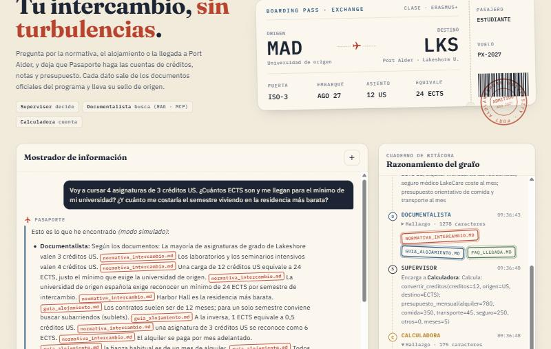
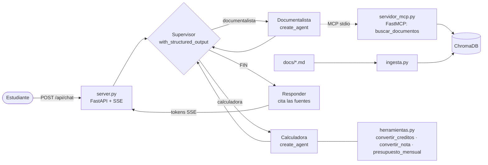

# Pasaporte · copiloto de intercambio universitario

> **Pruébalo sin instalar nada:** <https://manucamposgv.github.io/Pasaporte/>
> Las cuatro preguntas sugeridas muestran respuestas reales grabadas del sistema completo. Para hacer tus propias preguntas, pega una clave gratuita de Groq en la página: se queda en tu navegador (ver «Versión web en GitHub Pages»).

## Qué es

**Pasaporte** es una web con un chatbot que acompaña a un estudiante en su intercambio en **Lakeshore University**, una universidad ficticia de la también ficticia ciudad de Port Alder. Resuelve dudas sobre normativa, alojamiento y llegada, y hace cuentas de créditos (ECTS ↔ US), notas (sobre 10 → letra y GPA) y presupuesto.

Detrás del chat está la arquitectura del manual *Agentes con LangChain y LangGraph, RAG con ChromaDB y MCP con FastMCP*: un supervisor en LangGraph reparte el trabajo entre un **documentalista** (RAG sobre ChromaDB, servido por un servidor **FastMCP**) y una **calculadora** (herramientas `@tool` locales). Un nodo final redacta la respuesta citando siempre los ficheros fuente.



*Captura hecha en modo simulado (sin clave de Groq): por eso la respuesta es una lista mecánica de hallazgos. Con el modelo real de Groq la redacción es natural.*

La web tiene estética de tarjeta de embarque: cabecera tipo billete (MAD → LKS, puerta, embarque), chat con respuesta en streaming y preguntas sugeridas, y un panel lateral, «Razonamiento del grafo», con la línea de tiempo de qué nodo actúa, qué encargo le da el supervisor y qué documentos cita (como sellos de pasaporte). Papel crema en modo claro y azul noche en modo oscuro, según el sistema o con el interruptor de la cabecera. En móvil el panel del grafo se pliega.

## Arquitectura



En ASCII:

```
INICIO -> supervisor -> (documentalista | calculadora) -> supervisor -> ... -> responder -> FIN
                              |
                              +-- MCP (stdio) --> servidor_mcp.py --> ChromaDB <-- ingesta <-- docs/
```

- **Supervisor**: decide quién actúa con `with_structured_output(Decision)`. Si un cálculo necesita datos de los documentos (factor ECTS/US, créditos mínimos, alquileres, seguro…), primero se los pide al documentalista y luego pasa los números a la calculadora. `MAX_PASOS = 5` evita bucles.
- **Documentalista**: `create_agent` con la herramienta `buscar_documentos`, que llega del servidor FastMCP mediante `MultiServerMCPClient`. Responde solo con lo que dicen los documentos y cita el fichero.
- **Calculadora**: `create_agent` con `convertir_creditos`, `convertir_nota` y `presupuesto_mensual`.
- **Responder**: redacta la respuesta final solo con los hallazgos y cita las fuentes (`.md`).
- **server.py**: crea el grafo una sola vez al arrancar (*lifespan*), mantiene abierta la sesión MCP (el servidor MCP se lanza una vez, no en cada búsqueda) y emite por SSE los pasos del grafo (`stream_mode=["updates", "messages"]`) y los tokens del nodo responder.

Eventos SSE de `POST /api/chat`:

| Evento | Datos | Cuándo |
|---|---|---|
| `decision` | `siguiente`, `tarea` | el supervisor decide |
| `hallazgo` | `nodo`, `texto` | un especialista termina |
| `fuentes` | `nodo`, `fuentes` | el documentalista cita ficheros |
| `nodo` | `nodo` | un nodo ha terminado |
| `token` | `texto` | trozo de la respuesta final (nodo responder) |
| `respuesta` | `texto`, `fuentes` | respuesta final completa |
| `error` | `mensaje` | algo ha fallado |
| `fin` | — | cierre del stream |

## Estructura de carpetas

```
pasaporte/
├── docs/                         # documentos del RAG (inventados)
│   ├── normativa_intercambio.md  # créditos, ECTS↔US, notas, learning agreement, plazos, idioma
│   ├── guia_alojamiento.md       # residencias, pisos, fianzas, barrios, transporte
│   └── faq_llegada.md            # visado, seguro, orientación, banco, móvil, comida
├── app/
│   ├── __init__.py
│   ├── config.py                 # rutas, LLM y embeddings
│   ├── ingesta.py                # RAG: documentos -> ChromaDB
│   ├── servidor_mcp.py           # servidor MCP con FastMCP (buscar_documentos)
│   ├── herramientas.py           # herramientas de la calculadora
│   ├── agentes.py                # documentalista y calculadora
│   ├── grafo.py                  # supervisor y flujo con LangGraph
│   └── simulado.py               # SOLO pruebas: LLM y embeddings simulados
├── web/
│   ├── index.html                # la web (HTML + CSS + JS, sin build); modo servidor o modo web
│   └── demo.json                 # respuestas reales grabadas para la versión de GitHub Pages
├── index.html                    # GitHub Pages: redirige a web/
├── server.py                     # FastAPI: GET /, GET /api/salud, POST /api/chat (SSE)
├── iniciar.bat                   # Windows: instala, hace la ingesta y abre la web
├── Dockerfile                    # imagen para Hugging Face Spaces (puerto 7860)
├── main.py                       # preguntar desde la consola
├── probar_mcp.py                 # probar el servidor MCP solo
├── requirements.txt
├── .env.example                  # plantilla del .env (el .env real no se entrega)
├── .gitignore
├── captura.jpg
└── README.md
```

`chroma_db/` (la base vectorial) y `.venv/` se crean al instalar y hacer la ingesta.

## Instalación

Necesitas Python 3.10 o superior.

1. Crea el entorno virtual y actívalo (desde la carpeta `pasaporte/`):

   ```bash
   python -m venv .venv
   source .venv/bin/activate        # En Windows: .venv\Scripts\activate
   ```

2. Instala las dependencias:

   ```bash
   pip install -r requirements.txt
   ```

   Son las del manual (incluida `fastmcp>=3.0,<4.0`) más `fastapi` y `uvicorn`.

3. Consigue una clave gratuita de Groq en <https://console.groq.com/keys> (no pide tarjeta).

4. Copia `.env.example` como `.env` y pon tu clave:

   ```
   GROQ_API_KEY=gsk_tu_clave
   MODELO=groq:openai/gpt-oss-120b
   ```

## Arranque rápido en Windows (doble clic)

Haz doble clic en `iniciar.bat`. La primera vez crea el entorno virtual, instala las dependencias, crea `.env` a partir de `.env.example` y hace la ingesta; después abre <http://localhost:8000> en el navegador y arranca la web. Pon tu clave en `.env` antes de preguntar. Para pararla, `Ctrl+C` en la ventana.

## Ejecución

Todo se ejecuta desde la raíz del proyecto (`pasaporte/`), con el entorno activado.

1. **Ingesta** (una vez, y otra cada vez que cambien los documentos). La primera vez descarga el modelo de embeddings (unos 220 MB):

   ```bash
   python -m app.ingesta
   ```

   Verás `Guardados N fragmentos en .../chroma_db`.

2. **Prueba del servidor MCP** (opcional, sin LLM):

   ```bash
   python probar_mcp.py "¿Cuánto cuesta la residencia más barata?"
   ```

3. **Prueba por consola** (opcional):

   ```bash
   python main.py "¿Cuántos ECTS son 12 créditos US?"
   ```

4. **Servidor web**:

   ```bash
   uvicorn server:app
   ```

   Abre <http://localhost:8000>. En <http://localhost:8000/api/salud> ves si el grafo está listo, qué modelo usa y qué herramientas MCP ha cargado.

### Modo simulado (sin clave de Groq o sin red)

Para probar la arquitectura completa sin Groq ni descarga de embeddings hay dos variables de entorno. No tocan el código de producción: solo hacen que `crear_modelo()` y `crear_embeddings()` devuelvan las clases de `app/simulado.py`.

| Variable | Efecto |
|---|---|
| `MODO_SIMULADO=1` | LLM de reglas en lugar de Groq (supervisor, agentes y responder simulados, con llamadas reales a las herramientas y streaming de tokens) |
| `EMBEDDINGS_SIMULADOS=1` | Embeddings léxicos (trigramas con *hashing*) en lugar de fastembed |

Si cambias `EMBEDDINGS_SIMULADOS`, borra `chroma_db/` y repite la ingesta: la base y la búsqueda deben usar los mismos embeddings.

```powershell
# Windows (PowerShell)
$env:MODO_SIMULADO="1"; uvicorn server:app
```

```bash
# Linux / macOS
MODO_SIMULADO=1 uvicorn server:app
```

Las respuestas simuladas son mecánicas: sirven para comprobar que todo está conectado, no para evaluar la calidad.

## Ejemplos de preguntas

**Solo documentalista**

- ¿Qué plazo tengo para cambiar asignaturas del learning agreement?
- ¿Qué seguro médico es obligatorio y cuánto cuesta?
- ¿Qué nivel de inglés me piden y con qué certificados?
- ¿Qué fianza hay que pagar en las residencias?

**Solo calculadora**

- ¿Cuántos ECTS son 15 créditos US?
- Tengo un 7,8 sobre 10 de media. ¿Qué letra y GPA es en Lakeshore?
- Calcula mi presupuesto mensual y de 5 meses: alquiler 900, comida 350, transporte 45, seguro 250 y otros 100.

**Las dos combinadas**

- Voy a cursar 4 asignaturas de 3 créditos US. ¿Cuántos ECTS son y me llegan para el mínimo de mi universidad? ¿Y cuánto me costaría el semestre viviendo en la residencia más barata?
- Si cojo 3 asignaturas de 3 créditos y un laboratorio, ¿cuántos ECTS reconozco?
- ¿Cuánto gastaría al mes en un estudio de Lighthouse Commons con meal plan, abono y seguro?

## Problemas frecuentes

| Síntoma | Causa probable | Solución |
|---|---|---|
| `ModuleNotFoundError: No module named 'app'` | Se ejecutó un fichero suelto o desde otra carpeta | Ejecuta desde la raíz con `python -m app.ingesta` y `uvicorn server:app` |
| Conflicto de versiones de `mcp` al instalar | FastMCP 4 pide mcp 2 y el adaptador de LangChain pide una anterior | Mantén `fastmcp>=3.0,<4.0` |
| `Connection closed` al cargar las herramientas MCP | El servidor MCP falló al arrancar | Ejecuta `python -m app.servidor_mcp` a mano para ver el error |
| El RAG no devuelve nada útil | No se hizo la ingesta, o se usó otro modelo de embeddings | Repite la ingesta con el mismo modelo que usa el servidor |
| Aparecen textos de documentos ya borrados | La ingesta añade y sobrescribe, pero no borra | Borra `chroma_db/` y repite la ingesta |
| La primera ejecución tarda mucho | Se descarga el modelo de embeddings (unos 220 MB) | Solo ocurre una vez; luego queda en caché |
| Error 429 | Límite por minuto del plan gratuito de Groq | Espera unos segundos y repite |
| Error 429 con «tokens per day (TPD)» | Límite diario del plan gratuito (200 000 tokens con `gpt-oss-120b`; una pregunta combinada gasta varios miles) | Espera a que se libere o usa otro modelo en `MODELO`, por ejemplo `groq:openai/gpt-oss-20b` |
| `404 model_not_found` (p. ej., con `llama-3.3-70b-versatile`) | Groq ha retirado ese modelo o tu cuenta no tiene acceso | Pon en `.env` un modelo de tu lista, p. ej. `MODELO=groq:openai/gpt-oss-120b` (ver «Versiones probadas») |
| `400 tool_use_failed` | El modelo pidió una herramienta con argumentos que no encajan en su esquema | El grafo lo anota como hallazgo y sigue; si se repite, prueba otro modelo |
| El supervisor repite pasos | No ve suficiente información para terminar | `MAX_PASOS` lo corta; mejora el prompt del supervisor |
| `/api/salud` dice `"ok": false` | El grafo no se pudo crear al arrancar (falta `.env`, falta `chroma_db/`…) | Lee el campo `error`; corrígelo y reinicia `uvicorn` |
| «Falta GROQ_API_KEY en .env» en el chat | No hay `.env` o no tiene la clave | Crea `.env` a partir de `.env.example`, o usa `MODO_SIMULADO=1` |
| La respuesta aparece de golpe y no token a token | Un proxy o antivirus almacena en búfer la respuesta SSE | Abre `http://localhost:8000` directamente; el servidor ya envía `Cache-Control: no-cache` y `X-Accel-Buffering: no` |
| `Address already in use` / `[WinError 10048]` | El puerto 8000 está ocupado | `uvicorn server:app --port 8001` |
| `UnicodeEncodeError` al imprimir en la consola de Windows | La consola no usa UTF-8 | `main.py` y `probar_mcp.py` ya la reconfiguran; en otros scripts, `set PYTHONIOENCODING=utf-8` |
| `400 There was an error parsing the body` al probar con `curl` en Windows | La consola manda el JSON con otra codificación | Guarda el cuerpo en un fichero UTF-8 y usa `--data-binary @cuerpo.json` |
| Los cambios en `docs/` no se ven en la web | El servidor MCP abrió ChromaDB al arrancar | Repite la ingesta y reinicia `uvicorn` |
| La web carga sin estilos tipográficos | Sin internet no llegan las fuentes de Google Fonts | No afecta al funcionamiento; se usan fuentes del sistema |

## Versión web en GitHub Pages

GitHub Pages solo sirve ficheros estáticos: no puede ejecutar Python. Por eso `web/index.html` tiene dos modos y elige solo:

| Dónde se abre | Modo | Qué ejecuta |
|---|---|---|
| `http://localhost:8000` (con `iniciar.bat` o `uvicorn server:app`) | **servidor** | El sistema completo en Python: LangGraph, ChromaDB, servidor FastMCP y Groq |
| `https://manucamposgv.github.io/Pasaporte/` (sin backend) | **web** | Sin clave: reproduce `web/demo.json`, respuestas **reales** grabadas del sistema completo para las cuatro preguntas sugeridas. Con la clave de Groq del visitante: el mismo grafo (supervisor, documentalista, calculadora y responder, con los mismos prompts y herramientas) se ejecuta en el navegador; la búsqueda es BM25 sobre los mismos `docs/*.md`, en lugar de ChromaDB + MCP |

La clave del visitante solo se envía a `api.groq.com` y se guarda en `sessionStorage`, así que se borra al cerrar la pestaña. Tu clave del `.env` no se publica nunca.

Para activar GitHub Pages: en el repositorio, **Settings → Pages → Build and deployment → Source: Deploy from a branch → Branch: `main` y carpeta `/ (root)` → Save**. En uno o dos minutos la web está en `https://manucamposgv.github.io/Pasaporte/`. El `index.html` de la raíz redirige a `web/`.

Para volver a grabar la demo, arranca el servidor real y guarda los eventos SSE de `/api/chat` de cada pregunta sugerida en `web/demo.json` (formato: `{"grabaciones": [{"pregunta", "eventos": [{"t", "tipo", "datos"}]}]}`).

### Con Docker

El `Dockerfile` arranca el sistema completo en el puerto 7860: `docker build -t pasaporte .` y `docker run -p 7860:7860 -e GROQ_API_KEY=gsk_... pasaporte`. Sirve para cualquier servicio que ejecute contenedores; Hugging Face Spaces lo admite, pero en noviembre de 2026 sus Spaces con Docker piden la suscripción PRO. Como esa web sería pública y usaría tu clave, `server.py` limita las preguntas por visitante y hora (`LIMITE_PREGUNTAS_HORA`, 30 por defecto).

## Cómo adaptarlo a otro tema

| Qué cambiar | Fichero |
|---|---|
| Los documentos | `docs/*.md` (Markdown con apartados `##`); después, borra `chroma_db/` y repite la ingesta |
| Nombre de la colección | `COLECCION` en `app/config.py` |
| Descripción de la búsqueda (la lee el LLM) | docstring de `buscar_documentos` en `app/servidor_mcp.py` |
| Herramientas de cálculo | `app/herramientas.py` y la lista `tools=[...]` de la calculadora en `app/agentes.py` |
| Instrucciones de los agentes | `system_prompt` en `app/agentes.py` |
| Qué sabe hacer cada especialista y cómo se combinan | `PROMPT_SUPERVISOR`, `PROMPT_RESPUESTA` y `MAX_PASOS` en `app/grafo.py` |
| Añadir otro especialista | `crear_especialistas` (`app/agentes.py`), el `Literal` de `Decision` y `rutas` (`app/grafo.py`), y `NOMBRES`/`INICIAL` y el mapa de nodos en `web/index.html` |
| Textos, preguntas sugeridas y estética | `web/index.html` |

## Usar el servidor MCP desde Claude Code

Como el buscador es un servidor MCP estándar, puedes registrarlo en Claude Code y preguntarle por los documentos. Desde la terminal, cambiando `/ruta/a/pasaporte` por la tuya:

```bash
claude mcp add --env PYTHONPATH=/ruta/a/pasaporte --transport stdio pasaporte \
  -- /ruta/a/pasaporte/.venv/bin/python -m app.servidor_mcp
```

En Windows, el Python del entorno está en `.venv\Scripts\python.exe`:

```powershell
claude mcp add --env PYTHONPATH="C:\ruta\a\pasaporte" --transport stdio pasaporte -- "C:\ruta\a\pasaporte\.venv\Scripts\python.exe" -m app.servidor_mcp
```

`PYTHONPATH` le dice a Python dónde está el paquete `app`, y la ruta del `.venv` asegura que el servidor arranca con las dependencias instaladas. Dentro de Claude Code, `/mcp` muestra si está conectado. Haz antes la ingesta.

## Versiones probadas

Probado en Windows 11 con Python 3.12.10:

| Paquete | Versión | Paquete | Versión |
|---|---|---|---|
| langchain | 1.5.2 | langchain-chroma | 1.2.0 |
| langgraph | 1.2.24 | chromadb | 1.5.9 |
| langchain-groq | 1.2.1 | fastmcp | 3.4.11 |
| langchain-mcp-adapters | 0.3.2 | mcp | 1.30.0 |
| fastembed | 0.9.1 | fastapi | 0.165.0 |
| uvicorn | 0.54.0 | langchain-core | 1.8.4 |

Qué se ha ejecutado: la ingesta y `probar_mcp.py` con los embeddings reales de fastembed; `main.py` con Groq real (`openai/gpt-oss-120b`) sobre la pregunta combinada; y el servidor y la web en el navegador (escritorio, móvil, modo claro y oscuro), también con `MODO_SIMULADO=1`.

**Sobre el modelo.** El manual usa Llama 3.3 (`groq:llama-3.3-70b-versatile`), pero en noviembre de 2026 ese modelo ya no está disponible en Groq (devuelve `404 model_not_found`). Por eso el modelo por defecto es `groq:openai/gpt-oss-120b`, gratuito en Groq y compatible con herramientas y salida estructurada. Se cambia con la variable `MODELO` del `.env`; para ver qué modelos tiene tu cuenta:

```bash
python -c "from groq import Groq; from dotenv import load_dotenv; load_dotenv(); print([m.id for m in Groq().models.list().data])"
```
